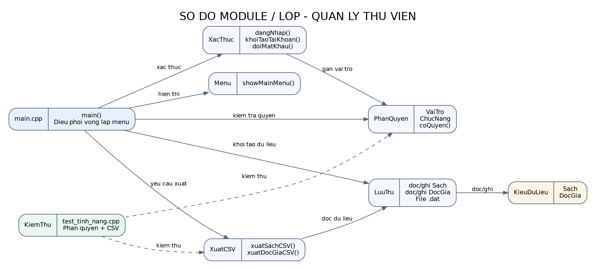

# Design - Thiet ke he thong QuanLyThuVien

**Phien ban:** 1.0 (thiet ke ban dau)  
**Pham vi:** kien truc module, menu/luong chinh, struct du lieu va mapping CTDL.

## 1. Nguyen tac thiet ke
- C++11 tro len; console menu; chia header trong `include/` va cai dat trong `src/`.
- Khong su dung co so du lieu. File `.dat` luu du lieu chinh; `.txt` luu log/bao cao; CSV dung cho xuat bao cao.
- Kiem tra du lieu va quyen tai cac diem xu ly, khong chi an muc menu.
- Cac CTDL bat buoc tu cai dat; khong dung container san de thay the CTDL ma bai yeu cau tu cai dat.

## 2. Cau truc module
- `main.cpp`: vong lap ung dung va dieu phoi luong menu.
- `menu.cpp`: hien thi menu theo vai tro.
- `phanquyen.cpp`: quy tac quyen truy cap.
- `xacthuc.cpp`: dang nhap, doi mat khau va doc tep tai khoan.
- `luutru.cpp`: doc/ghi file nhi phan sach va doc gia.
- `xuatcsv.cpp`: chuan hoa truong CSV va xuat danh sach.
- `cacstruct.h`: kieu du lieu dung chung.

## 3. Menu va luong chuong trinh
1. Khoi dong, kiem tra/tao thu muc du lieu va nap du lieu mau neu chua co.
2. Nap tai khoan demo neu `data/taikhoan.dat` chua ton tai.
3. Dang nhap (toi da 3 lan sai trong mot lan goi).
4. Hien thi cac lua chon duoc phep theo vai tro.
5. Kiem tra quyen lan nua truoc khi thuc thi chuc nang.
6. Dang xuat de quay ve man hinh dang nhap hoac chon thoat.

## 4. Struct du lieu hien co va du kien
- `Sach`: ISBN, ten sach, tac gia, the loai, nam xuat ban, so luong tong, so luong con.
- `DocGia`: CMND/CCCD, ho ten, email, so dien thoai, loai the.
- Se bo sung `PhieuMuon`, `GiaoDich`, `TaiKhoan`, `Ngay` khi cac module tuong ung duoc trien khai.

## 5. Map CTDL theo de bai
| CTDL | Vi tri su dung | Thao tac / do phuc tap muc tieu |
|---|---|---|
| AVL | chi muc sach theo ISBN | tim/them/xoa O(log n) khi cay can bang |
| BST | in danh muc tang dan | in-order O(n), tim O(h) |
| Hash Table separate chaining | tra cuu doc gia theo CMND/CCCD | trung binh O(1), xau nhat O(n) |
| Danh sach lien ket don | danh sach phieu muon | them dau O(1), tim O(n) |
| Mang dong | lich su giao dich | truy cap theo chi so O(1), them cuoi amortized O(1) |
| Do thi danh sach ke + BFS/DFS | goi y sach lien quan/cung the loai | duyet O(V+E) |
| CTDL cay tu tim hieu | phan nang cao | can chot loai cay cu the voi giang vien truoc khi code |

Do phuc tap la muc tieu ly thuyet; can do benchmark thuc te va bao cao khi da co cai dat.

## 6. Luu tru va dinh dang
- `data/sach.dat`: danh sach sach.
- `data/docgia.dat`: danh sach doc gia.
- `data/taikhoan.dat`: tai khoan demo dang nhi phan.
- `data/nhatky/`: log `.txt` (se hoan thien).
- `data/saoluu/`: backup theo ngay (se hoan thien).
- `data/xuat_sach.csv`, `data/xuat_docgia.csv`: file CSV sinh ra khi su dung menu xuat.

## 7. Unit test va benchmark
Unit test hien tai bao gom ma tran quyen va escaping CSV. Sau khi cai dat AVL/BST/Hash Table/graph, bo sung test them/xoa/tim, va kiem tra invariants. Benchmark nen tao du lieu theo nhieu quy mo, ghi thoi gian vao CSV va ve bieu do so sanh.

## 8. Ghi chu pham vi
Bo code hien tai moi la bo khung cho dang nhap, phan quyen, file sach/doc gia va CSV. Cac module nghiep vu va CTDL bat buoc se duoc phat trien theo checklist, khong nen xem menu cho la da hoan thanh chuc nang.
